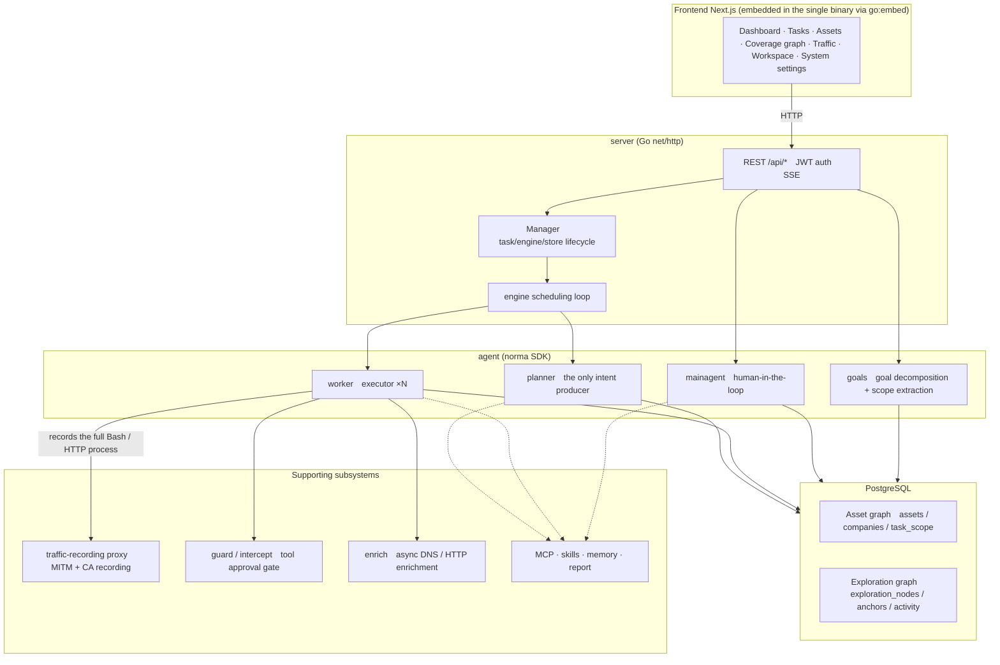
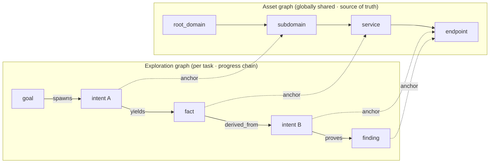
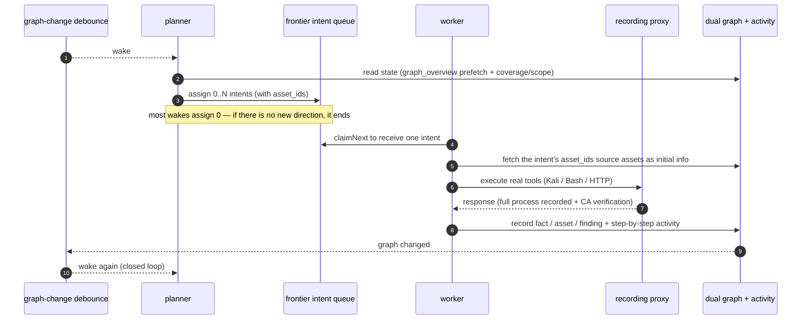
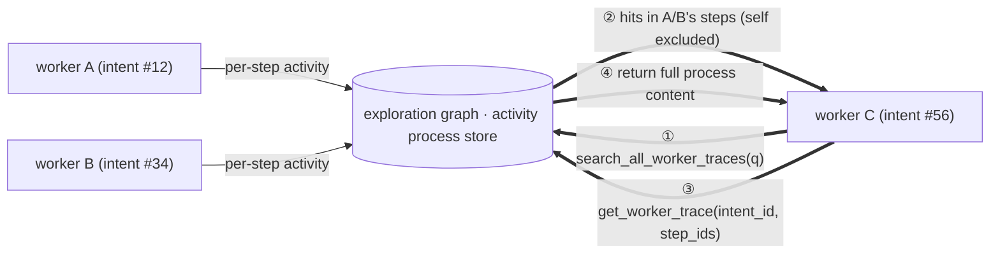
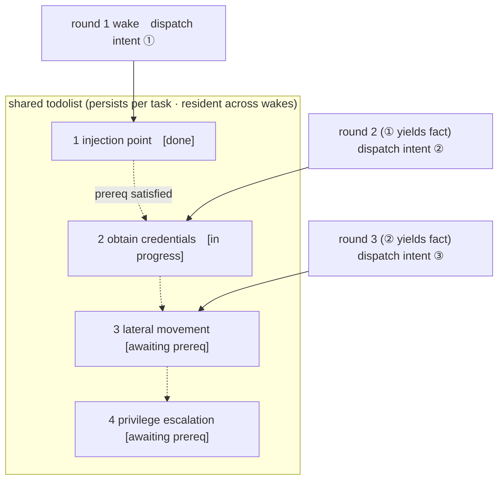

<div align="center">

# ARTEX — Korean Edition

**An autonomous penetration-testing system driven by LLM multi-agents** (Go backend + Next.js frontend)

The UI and generated output default to Korean, and **can be switched to English, Chinese or Spanish in Settings (System → Settings → Display language).** Changing the language also changes the language of agent-generated reports, summaries and chat replies.

[한국어](README.md) · [中文](README.zh.md) · English

[](https://github.com/jiwoochris/artex-ko/actions/workflows/ci.yml) [](https://github.com/jiwoochris/artex-ko/actions/workflows/detections.yml) [](https://github.com/jiwoochris/artex-ko/actions/workflows/web.yml) [](LICENSE)

</div>

---

> ## 🚨 Security & misuse warning — read this first
>
> **This repository is published for use only within authorized environments, and only to build defensive and detection capabilities.**
>
> ARTEX is an autonomous offensive tool powerful enough to carry an attack from reconnaissance through intrusion to data exfiltration with little human involvement, so the harm from misuse is correspondingly large. In October 2026, several Korean news outlets reported that investigators had found indications the upstream ARTEX was used in personal-data breaches targeting Korean financial institutions; the related investigation is ongoing. This Korean edition is not published to help attackers. Its purpose is to help defenders understand how such autonomous AI attacks work and build the capability to detect and block them.
>
> - **Unauthorized use is a crime in itself.** Do not run any scanning, probing, or exploitation against systems you do not own or for which you lack explicit written authorization. In the Republic of Korea, unauthorized intrusion into an information and communications network violates the Network Act, and the Personal Information Protection Act also applies where personal data is involved.
> - **Do not target live services or other parties' assets.** Verify only in learning, research, and locally isolated environments you own (deliberately vulnerable targets such as OWASP Juice Shop or DVWA).
> - **Read it from a defender's point of view.** This repository also compiles defensive and detection material, such as detection signatures and hardening checklists, for autonomous AI attacks. → **[Defense & Detection Guide](docs/defense-en.md)** (also in [Korean](docs/defense-ko.md))
>
> If you do not agree to this warning and to the [usage restrictions and disclaimer](#license-and-disclaimer) below, do not download or use this repository.

---

> **This repository is a localized edition of the Chinese open-source project [Autumn-27/ARTEX](https://github.com/Autumn-27/ARTEX) (AGPL-3.0 · upstream repository currently unreachable, checked 2026-10), adapted so that Korean users and teams can adopt it as-is.** To preserve the agents' decision-making performance, the internal reasoning prompts are kept in the original language, and only the user-facing output (findings, summaries, reports, chat replies) is forced into Korean. See ["Why a Korean edition"](#why-a-korean-edition) below for the rationale.

ARTEX is a system in which several LLM-driven agents autonomously run a penetration test: they **break goals down on their own, execute real tools, and accumulate discovered assets and vulnerabilities into a graph** as they go. A single Go binary ships with the Next.js frontend embedded, and all data is stored in PostgreSQL.

> **Note on this edition's language.** The product UI, prompts, and user-facing output of this fork are being localized to **Korean**, not English. This English README exists so international readers can understand what the project is, how it differs from upstream, and how to run it. If you want the agent output in another language, see [Configuration](#configuration) — the output language is enforced by a small code-fixed directive that can be adapted.

---

## ⚠️ Read first — authorized use and legal notice

ARTEX may be used **only against targets you own or for which you have explicit written authorization.** Any scanning, probing, or exploitation beyond the authorized scope may itself be illegal.

- In the Republic of Korea, intruding into or disrupting another party's information and communications network without authorization violates the **Act on Promotion of Information and Communications Network Utilization and Information Protection** (정보통신망법).
- Personal data collected or exposed during a penetration test is subject to the Korean **Personal Information Protection Act** (개인정보보호법). Even with authorization, handle the access, retention, and deletion of personal data with care.
- Wherever you are, comply with your own jurisdiction's laws on network security, data protection, and computer crime.
- Use this for **learning, research, and verification in locally isolated environments.** Before targeting any live external system, secure written authorization and an agreed scope and time window.

Full license terms, usage restrictions, and the disclaimer are in the [License and disclaimer](#license-and-disclaimer) section below. Using this tool constitutes your agreement to those terms.

---

## Why a Korean edition

Upstream ARTEX has its prompts, UI, and documentation entirely in Chinese, which made it cumbersome for Korean users to read the results and share them with a team. This edition aims to:

- **Localize the output** — the findings, fact summaries, final reports, and chat replies that agents surface to a human are forced into Korean. Commands, payloads, code, URLs, and raw logs are needed for analysis and are left in their original form.
- **Preserve performance** — the internal reasoning prompts (the behavioral instruction body) that drive the agents' judgment are **not** translated. Behavior benchmarked in the original language is kept intact, and only the output language is changed, avoiding the quality drift that translation introduces.
- **State the legal boundaries** — the notices on Korean network and privacy law and the "authorized scope only" warning are provided clearly in Korean.
- **Support the local stack** — the LLM provider can be swapped from a frontier model to any OpenAI-compatible endpoint (domestic or open models). See [Configuration](#configuration).

> The boundaries and design policy of this localization are documented in more detail in the repository's working notes. To make it easy to diff against the upstream repository, the original Chinese document is preserved as [`README.zh.md`](README.zh.md).

---

## Screenshots

The three screens below are the localized Korean UI. The data comes from a local, isolated sandbox: every target is the fictional `acme.com` and private address ranges.

<p align="center">
  <br>
  <sub><b>Dashboard</b> — active tasks, confirmed findings, asset nodes, LLM token spend, and the activity feed on one screen.</sub><br>
  <sub>This dashboard image was captured before the card labels were localized, so the data-source name on the "LLM Token 소비" card still reads as the raw identifier <code>llm_usage</code>. The current build shows the localized labels there instead: 「계량 원장」 (new) and 「활동 통계」 (old).</sub>
</p>

<p align="center">
  <br>
  <sub><b>Findings</b> — results aggregated by severity, status, asset, and owning task, exportable to CSV.</sub><br>
  <sub>Finding <b>titles</b> are model-generated, so English technical terms can appear, mirroring the target app ([Model selection and output language](#model-selection-and-output-language)). The description under each title and the rest of the UI are Korean.</sub>
</p>

<p align="center">
  <br>
  <sub><b>Chat</b> — a human steps into the autonomous run to inject hints while the agent summarizes the attack chain in Korean.</sub>
</p>

The original (Chinese UI) screens are available in [`README.zh.md`](README.zh.md#截图预览) (Chinese UI).

---

## Quick start (Docker Compose)

> **Prerequisites:** Docker and Docker Compose. The database is **PostgreSQL**, brought up by compose. Exploration requires an **LLM** (`ANTHROPIC_API_KEY` or `OPENAI_API_KEY`; can also be set in the UI).

> **⚠️ The `docker compose up -d` quick start below does not work right now.** The `artex` service in `docker-compose.yml` is set to pull `autumn27/artex`, the upstream (original) image, but that image has been taken down from Docker Hub and can no longer be pulled (verified 2026-10-09). As a result this command fails at the image-pull step with `pull access denied` / `manifest unknown`. To get the Korean edition's screens and output, build it via the **single-binary build from source** path under ["Other installation methods"](#other-installation-methods) below, which currently works. A Korean-edition Docker image is in the works.

```bash
git clone https://github.com/jiwoochris/artex-ko.git
cd artex-ko
cp .env.example .env          # set POSTGRES_PASSWORD; ANTHROPIC_API_KEY is optional
docker compose up -d          # brings up the artex image + postgres together
# → open http://localhost:8787 (on first visit, set the admin password at /setup)
#   /setup asks for the setup token printed in the startup log: docker compose logs artex | grep '설정 토큰'
```

The upstream image bundles common tools (ripgrep, curl, vim, npm, nmap, and more), and when brought up with compose, `./skills` and `./data` are bind-mounted to the host and survive container recreation. As noted in the warning above, though, that image currently cannot be pulled, so this Docker path is unavailable for now; build the Korean edition via the source compile below.

### Other installation methods

Upstream provides several methods: an install script (`./install.sh`), precompiled binaries (Releases), and a single-binary build from source. The commands and full procedure are collected in the "安装" (Installation) section of [`README.zh.md`](README.zh.md#安装) (in Chinese); the essentials are reproduced below.

- **Install script:** running `./install.sh` detects/installs Docker and then lets you choose "① all-in-Docker" or "② local compile and run." Note that the default "① all-in-Docker" tries to pull the same upstream image (`autumn27/artex`) as the quick start above, but that image has been taken down from Docker Hub (see the warning above), so this path currently fails at the image-pull step; the script detects this and prints the same notice before stopping. To get the Korean edition's screens and output, choose "② local compile and run" or use the **single-binary build from source** path below.
- **Single-binary build from source:**

  ```bash
  cd web && npm ci && npm run build:static && cd ..   # 1) static frontend build
  rm -rf server/webui/dist && mkdir -p server/webui/dist && cp -a web/out/. server/webui/dist/   # 2) sync into the embed directory (avoids nesting on rebuild)
  CGO_ENABLED=0 go build -tags embedui -o artex ./cmd/artex   # 3) compile with the frontend embedded
  ./start.sh                                          # → http://localhost:8787
  ```

> The `npm ci` in step 1) installs the devDependencies the build needs (e.g. `@tailwindcss/postcss`). If your shell has `NODE_ENV=production` set, `npm ci` skips devDependencies and the build fails with `Error: Cannot find module '@tailwindcss/postcss'`; in that case install with `npm ci --include=dev`.

> Launch with `start.sh` (`start.bat` on Windows) rather than running `./artex` directly. That script is a supervisor that restarts the program based on its exit code, and it also handles the UI's "one-click update."

---

## Configuration

**Database** (`config.json`, or override with the `ARTEX_PG_DSN` environment variable):

```json
{
  "database": {
    "host": "127.0.0.1", "port": 5432,
    "user": "artex", "password": "yourpass",
    "dbname": "artex", "sslmode": "disable"
  }
}
```

**LLM:** `export ANTHROPIC_API_KEY=sk-...` (or `OPENAI_API_KEY`), or enter it on the UI's "LLM settings" page. Instead of an API key you can also sign in with a ChatGPT Plus/Pro subscription ([see below](#using-a-chatgpt-subscription-no-api-key)), and — for personal use on your own PC only — use a Claude subscription through the official `claude` CLI that you signed in to yourself ([see below](#using-a-claude-subscription-official-claude-cli-personal-local-use-only)). Optional environment variables: `ARTEX_LLM_PROVIDER` / `ARTEX_LLM_MODEL` / `ARTEX_LLM_BASE_URL` / `ARTEX_LLM_PROXY`. To use a domestic or open model, point `ARTEX_LLM_BASE_URL` at an OpenAI-compatible endpoint.

**Output language:** this edition forces user-facing output into Korean via a small, code-fixed directive appended to each role's system prompt (it does not translate the reasoning body). If you need a different output language, adapt that directive in `agent/prompt.go` (`langDirective`).

**Concurrency:** the number of worker agents spawned per task is adjustable under "System settings" (default 3).

**Common flags:** `./start.sh -addr :8787 -proxy :8788` — `-addr` is the frontend and API, `-proxy` is the traffic-recording proxy port. `-addr` defaults to `127.0.0.1:8787` (local connections only); pass an explicit bind address such as `:8787` to serve other machines (see "First-run protection" below).

### Using a ChatGPT subscription (no API key)

You can run models on the usage of a ChatGPT Plus/Pro subscription. This uses OpenAI's official "Sign in with ChatGPT" token-sharing path for open-source and locally run apps; instead of API-key billing, the plan limits of that ChatGPT account apply. Only authentication changes. The agent loop and tool calling keep using the existing `openai-responses` path (Responses API, `store:false`), so with the same model it behaves the same as with an API key.

**How to use it**

1. Under "System → LLM", click "New" and set **Authentication** to "ChatGPT subscription (Plus/Pro)".
2. Enter a name and a model, then click **"Sign in with ChatGPT"**. The profile is saved first and OpenAI's sign-in and consent page opens in a new tab. After you approve, the browser returns to `http://127.0.0.1:<port>/auth/callback` and ARTEX finishes the connection automatically (`<port>` is the port you reached ARTEX on; 8787 by default). The consent must include permission to use your ChatGPT plan usage. If it was not granted, the card shows "Permission needed" and "Allow permission again" signs you in again.
3. Once signed in, the refresh button next to the model field loads **the models this account can use** (you can still type a model that is not listed). Pick a reasoning effort (`reasoning.effort`), run "Test connection" to confirm a real call, and save.
4. (Optional) **Daybreak**: if the account is approved for OpenAI's Trusted Access for Cyber (Daybreak), the "Enable Daybreak" switch sends `access_programs.cyber=daybreak_blue` with every request. Account approval and enablement by a workspace admin come first (on an unapproved account it may have no effect or return an error); when off (default) nothing is sent. Only Blue is supported, not Red. The official documentation does not state whether this subscription path accepts that field, so confirm with "Test connection".
4. Set the profile active on its card, or assign it to tasks and agents. Signing out asks OpenAI to revoke the refresh token and deletes the tokens on this server.

**When the browser is on a different computer than the ARTEX server (remote server / Docker)**

OpenAI's redirect address must be `http://127.0.0.1:<port>/auth/callback` (only the port may vary), so it returns automatically only when the browser runs on the same host as ARTEX. With Docker, port 8787 is published on the host, so a browser on that host works automatically. If the browser is on another computer, it is normal for the `127.0.0.1` page not to load after you approve. Then **copy the full URL from the address bar** and paste it into the "Finish by pasting" box in the sign-in area to complete the same sign-in (the code is single-use and must be used within 10 minutes).

**Usage limits and failover**

You can set a weekly per-app limit under "Usage" in ChatGPT settings. When it is reached the error `subscription_sharing_usage_limit_exceeded` is returned. The OpenAI documentation says a subscription request must not be switched to another billing path automatically, so ARTEX does not treat this like an exhausted balance or quota on an API key: even with "LLM rotation" enabled it does **not** fail over to a paid API-key profile. It surfaces the error with a note that the limit was reached. Raise the limit under "Usage" in ChatGPT settings or retry once it resets (transient errors such as `subscription_sharing_usage_unavailable` are not a limit-exceeded condition).

**Known limits and cautions**

- **The output token cap (`max_tokens`) cannot be sent.** The direct subscription path does not support some request fields such as `max_output_tokens`, so ARTEX removes them. Responses always stream and the session header is not used. Those inputs are hidden for this authentication method.
- **Tokens are stored in the database at the same protection level as API keys (`llm_profile_oauth`, plain text).** They never appear in the UI, API responses, logs or LLM call records (llmrec), but anyone with access to the database or its backups can read them, so restrict that access. The refresh token rotates on every refresh, so running several ARTEX processes against one database is not supported (refresh serialization holds only inside one process).
- **Personal, local use only.** The OpenAI cookbook makes ChatGPT plan usage available to open-source projects and personal projects that run locally, and says paid or remotely hosted apps need waitlist approval. Do not use one account to serve several people.
- **Scope of verification.** The flow from the official documentation was implemented and tested against a mock issuer and mock servers (unit and integration tests). This repository's CI makes no end-to-end calls to the real `auth.openai.com` or `api.openai.com`, so in a new environment confirm with "Test connection". The model list and the supported reasoning efforts depend on the account and on the time.

**Policy basis.** ARTEX uses only the method OpenAI has published. It does not read another tool's token file (such as Codex CLI's `~/.codex/auth.json`), borrow its client ID or call ChatGPT's internal `backend-api`; it calls only the public Responses API (`https://api.openai.com/v1/responses`).

- [Sign in with ChatGPT cookbook](https://developers.openai.com/cookbook/articles/sign-in-with-chatgpt)
- [Token sharing (open source) — sign in](https://developers.openai.com/siwc/token-sharing-open-source/sign-in)
- [Token sharing (open source) — models and inference](https://developers.openai.com/siwc/token-sharing-open-source/models-and-inference)
- [OpenAI Help: supported open-source tools](https://help.openai.com/articles/20001542)

**A Claude subscription (Pro/Max)** can be used only in the separate form below. Third-party apps offering Claude.ai login, or taking a user's credentials to send requests on their behalf, are not permitted by Anthropic's terms and remain unsupported.

### Using a Claude subscription (official claude CLI, personal local use only)

> **Off by default.** This feature is only for using your own Claude Pro/Max subscription **on your own PC, by yourself**. Do not expose this ARTEX to other people or share your subscription. Test only targets you are authorized to test and do not try to bypass Claude's refusals. Whether automated use falls within the subscription terms is Anthropic's call, and Anthropic may restrict or suspend access if they are violated. You are responsible for your use.

**How it works.** ARTEX runs the **official `claude` CLI** — installed and signed in by you — as a child process in headless mode (`claude -p`, stream-json input and output). ARTEX never reads (`~/.claude/.credentials.json`, the keychain, `CLAUDE_CODE_OAUTH_TOKEN`, ...), stores, logs or forwards Claude credentials. It does not call `api.anthropic.com` with subscription credentials, does not send headers that impersonate Claude Code, and does not modify, patch or wrap the `claude` binary; it uses documented flags only. Authentication happens entirely inside `claude`; all ARTEX reads is the login state and the authentication method (`authMethod`) from the JSON that `claude auth status` prints.

**Agent behaviour is kept as close as possible to the API Key path.** ARTEX keeps the agent loop, and one model call corresponds to one `claude` response (a provider bridge). All of `claude`'s built-in tools are turned off (`--tools ""`) and only ARTEX's tools are shown, over an MCP server reachable on `127.0.0.1` only (names get a `mcp__artex__` prefix). A tool call holds the MCP response open until ARTEX has executed the tool and returns its result, so permission checks, approvals, hooks, traffic capture, finding/asset/graph writes, transcripts and activity records are handled by the same ARTEX code as the API Key path. Role prompts are passed through `--system-prompt-file` untranslated and unmodified.

**How to use it**

1. In a terminal, install Claude Code (2.1.259 or newer) and sign in to your own subscription **yourself** with `claude auth login`. `claude auth status` should report the method `claude.ai`.
2. Under "System → LLM" choose "New" → **Authentication** "Claude Code (subscription, personal local use)". Read the notice in the panel, tick the confirmation box and **turn it on** (an opt-in switch for the whole installation).
3. Set the model (type an alias such as `sonnet` or `opus`, or a full name; blank uses `claude`'s default model) and the reasoning effort (`low` to `max`, passed as `--effort`), check it with "Test connection", then save. If `claude` is missing, too old or not signed in, the panel and the test result say why.
4. "Set active" on the card, or assign this profile to a task or agent.

**Environment and isolation**

- The child process environment is built from an **allowlist**: only `PATH`, `HOME`, locale, temp-directory, Windows system, proxy/TLS variables, `CLAUDE_CONFIG_DIR` and `XDG_*` are passed on, everything else is dropped. That removes `ANTHROPIC_API_KEY` and `ANTHROPIC_AUTH_TOKEN` (if present, `claude` would use API billing instead of the subscription), `CLAUDE_CODE_OAUTH_TOKEN`, `ANTHROPIC_BASE_URL`, `CLAUDE_CODE_USE_*` routing switches and any such variable added in the future. Your personal settings (CLAUDE.md, auto memory, hooks, plugins, background tasks, ...) are kept out of the agent through environment variables and flags, and the process runs in a dedicated empty working directory. `--bare` is not used because it ignores subscription login.
- If `authMethod` is not `claude.ai` or `oauth_token` (`api_key`, `api_key_helper`, third-party providers, ...) it is **treated as an API-billing path and refused**.
- The MCP endpoint listens on a random port on `127.0.0.1` only, uses a 256-bit per-process token in its path, and checks the Host and Origin headers.
- It will not turn on while ARTEX is reachable on an address other than `127.0.0.1` (a deployment you have checked yourself, for example a container whose port is published only on the host's `127.0.0.1`, can be allowed with the environment variable `ARTEX_CLAUDE_CODE_ALLOW_NONLOOPBACK=1`). The official Docker image does not contain `claude`, so this feature is best used with ARTEX running directly on your host.

**Limits and concurrency**

- The global cap on `claude` processes producing a model response at the same time defaults to 1 and cannot be set above 3. Processes waiting for a tool to run do not hold a slot. If a response produces no output for a while (10 minutes by default) the process is considered stuck and is cleaned up so the slot is returned (time is extended while `claude` reports that it is retrying the API, up to a fixed count).
- Up to 8 live (waiting) `claude` processes are kept by default; beyond that, idle sessions are evicted before sessions waiting for a tool result, oldest first within each class (an evicted session continues on its next call by replaying the transcript). Tune it with the environment variable `ARTEX_CLAUDE_CODE_MAX_LIVE`.
- When a subscription usage limit is hit, no new requests are sent (until the reported reset time; 30 minutes if unknown, 12 hours at most) and the error is surfaced. The 5-hour and weekly limits apply to the whole account, but a per-model limit (for example the weekly Opus limit) blocks only profiles of that model. With "LLM rotation" on, ARTEX fails over to the next profile. Transient rate limits and overload back off exponentially from 30 seconds to 5 minutes. There are no tight retries and no switching between accounts.

**Known limits (differences from the API Key path)**

- `claude`'s own agent loop and automatic context compaction can run alongside ARTEX's compaction.
- After ARTEX compacts the start of the conversation, or after a process restart or a 10-minute idle expiry, the conversation is **fed back as a text transcript** (not as structured `tool_use` blocks). The content is the same but the form the model receives differs slightly.
- The default prompt is replaced with `--system-prompt-file`, but the binary may still prepend its own identity text. The `mcp__artex__` prefix on tool names is explained by a short, code-fixed note at the end of the system prompt.
- The output token cap, temperature, per-second/minute rate limits and the thinking type do not apply (hidden in the UI). Responses always stream.
- When the same tool is called several times at once with identical arguments, matching results to calls depends on arrival order. With different arguments they are matched exactly by arguments.
- Passing a token made by `claude setup-token` through the `CLAUDE_CODE_OAUTH_TOKEN` environment variable is not supported. Because ARTEX does not forward credentials, it removes that variable from the child environment; use the login that `claude auth login` stores.
- Some user-facing errors appear in Korean only.
- **Verification scope.** The shape of `claude`'s stream-json output is an assumption based on the official documentation, and this repository's tests run against a fake `claude` that follows it (tool round trip, several tools, usage limit, crash, cancellation, concurrency cap, environment sanitising, ...). End-to-end calls against the real `claude` are not made in CI, so on a new setup check with "Test connection" and a short task first.

**Policy basis and what is uncertain.** Anthropic's documentation describes Claude Code as the official CLI and `claude -p` (headless) and `claude setup-token` as meant for scripts and automation, and it distinguishes an individual using the official CLI with their own subscription from a third party handling credentials or serving other people with a subscription. ARTEX takes only the former shape. However, the consumer terms restrict automated access that is not explicitly permitted and account sharing, and allow suspension without prior notice, so **whether an agent loop that runs overnight counts as "ordinary individual usage" is for Anthropic to decide, and ARTEX cannot guarantee it.** Using the model with an API key is the safest choice, and third-party apps offering Claude.ai login or routing requests through a user's Free, Pro or Max credentials remain unsupported.

- [Claude Code legal and compliance](https://code.claude.com/docs/en/legal-and-compliance)
- [Authentication](https://code.claude.com/docs/en/authentication)
- [Headless usage (`claude -p`)](https://code.claude.com/docs/en/headless)
- [CLI reference](https://code.claude.com/docs/en/cli-reference)
- [Anthropic consumer terms](https://www.anthropic.com/legal/consumer-terms)

### Model selection and output language

The Korean localization is **driven by a prompt directive (`langDirective()` in `agent/prompt.go`), not a hard-coded cap.** So how consistently the output stays in Korean depends on the model's capability, the role, and the context.

- **Use a capable frontier model.** In a short validation run that applied only the production directive against a local isolated sandbox, the default model `claude-opus-4-8` kept user-facing output in Korean across all four roles — planner, worker, reporter, and an authorized-sandbox planning request — with no refusals. `gpt-4o` also stayed in Korean on the same scenarios. A cheaper, smaller model (for example `gpt-4o-mini`), by contrast, let the report fall back to the original language. Output-language quality tracks model capability directly, so use a capable model wherever a human reads the report.
- **Some role- and context-dependent drift remains.** Divergence shows up in role and output format more than in language itself. In particular, short outputs such as the worker's final one-sentence summary can expose the model's English chain-of-thought verbatim, and the structured fields of `report_finding` can lean toward English, mirroring the target app and its technical terms. In an earlier run, `gpt-4o`'s planner situation summary also reverted to the original language on some turns. Stating "write in Korean" explicitly in the task instruction raises the fidelity.
- **Give reasoning models a generous `max_tokens`.** A reasoning model that uses a separate thinking channel can spend a small response-token budget entirely on internal reasoning and leave the user-facing final answer empty. Here the answer itself disappears rather than the language, so set that LLM profile's `max_tokens` high enough.

> **Token-cap pitfall on the OpenAI-compatible path.** OpenAI-family models such as `gpt-4o` cap response tokens at 16,384. OpenAI-compatible requests, however, carry a larger default output cap (32,768), so leaving it unchanged makes every call fail with `400 (max_tokens is too large)`. In that case, **set that profile's `max_tokens` to 16,384 or lower on the LLM settings page.** Anthropic-family models (including the default `claude-opus-4-8`) allow 32,768 and do not hit this pitfall.

### First-run protection (setup token and bind address)

There is a single admin account (`ARTEX`) whose password is created on the first visit at `/setup`. So that whoever reaches a not-yet-initialised instance first cannot claim it, the following protections apply.

- **Setup token.** When the server starts without a password it prints one line `[auth] … 설정 토큰: …` (setup token) to the console (`docker compose logs artex` under Docker). `/setup` and `POST /api/auth/init` (`setup_token` field) only create the password when that value matches, and wrong attempts are rate-limited. For unattended deployments pin it with `ARTEX_SETUP_TOKEN`, or set the password directly with `ARTEX_ADMIN_PASSWORD` (8+ characters).
- **Binds to 127.0.0.1 by default.** Both the `-addr` default of `artex` and the port publishing in `docker-compose.yml` open the loopback interface only. To reach it from other machines use `-addr :8787` or `ARTEX_BIND=0.0.0.0` in `.env`, but finish the initial setup first and prefer the reverse-proxy layout below. Starting without a password on a non-loopback address logs a warning.
- **Changing the password ends every session.** The token signing key is bound to the password hash, so tokens issued before a change (from the UI, `reset-password.sh`, or a direct DB edit) stop working within seconds. When recovering from a compromised account, also review custom tools, MCP, LLM and notification settings after changing the password.
- **CORS.** `/api` only answers cross-origin browser calls from origins listed in `ARTEX_CORS_ORIGINS` (comma-separated). The embedded UI is same-origin, so this is normally empty; the default only allows `next dev` from `dev.sh` (`http://localhost:5173`).

### Reverse-proxy deployment (HTTPS / expose only 443)

The frontend and the API/SSE are both served by the same backend port (default `:8787`), and the live activity stream connects **same-origin** by default. So there is no need to set `NEXT_PUBLIC_SSE_BASE` separately: expose only 443 to the public network and keep 8787 internal.

SSE holds a long-lived connection and keeps pushing events, so you **must disable buffering** in the reverse proxy. If you don't, the browser connects but receives no events (the activity stream appears stuck loading). An Nginx configuration example is in [`README.zh.md`](README.zh.md#反向代理部署https--只开放-443).

---

## System architecture

ARTEX is an **autonomous penetration system driven by LLM multi-agents.** It uses a single Go backend (with the Next.js frontend embedded) over PostgreSQL, and the agent capabilities are provided by the [`norma`](https://github.com/Autumn-27/norma) (currently unreachable, checked 2026-10) SDK. At its core is a **dual-graph structure** and the two autonomy mechanisms around it: process-level information exchange between workers, and the planner's multi-round shared todolist.

### Overall layers



- **Frontend** — the Next.js static build is embedded into the single binary with `go:embed`. It visualizes tasks, assets, exploration chains, and the coverage graph, and provides the human-in-the-loop chat.
- **server** — handles `net/http` routing, JWT auth, and SSE; the `Manager` owns the lifecycle of tasks, engines, and the DB store.
- **engine** — per task, runs one `plannerLoop` and N worker goroutines, handling intent assignment, timeouts, pause, and drain.
- **agent** — split into goals / planner / worker / mainagent; the `ToolSet` exposes the dual graph as LLM tools.
- **db** — stores the dual graph in PostgreSQL (pgx); the schema embedded via `go:embed` idempotently creates the tables on every startup.
- **support** — the recording MITM proxy, the approval gate, async enrichment, and MCP / skills / memory / report.

### The dual graph: exploration graph + asset graph

The system separates "what the target is" from "how far it has been tested" into two graphs that are independent yet linked by anchors.

- **Asset graph (globally shared)** — the source-of-truth asset store shared across tasks. Nodes are `root_domain / subdomain / ip / service / app / endpoint` and belong to a company. The parent-child relationships (domain → subdomain → service → endpoint) and the dedup keys are all computed by the program; agents submit only the raw information.
- **Exploration graph (independent per task)** — the "thinking and progress" of a single task. Nodes are `goal / intent / fact / finding / hint`, connected by edges such as `spawns / derived_from / yields / proves` to form lineage chains.
- **The two graphs are linked by anchors** — `exploration_anchors(node_id, asset_id)` pins intents, facts, and findings to concrete assets. This lets you query, from the exploration side, which asset a direction was attacking, and conversely which intent tested a given asset in this task and what facts it produced — in both directions.



> Division of roles: the **planner** reads the state of the exploration graph and judges goals, emitting **intents** to the frontier only when there is a new direction not yet covered. A **worker** takes a **single intent**, executes it with real tools, writes the new assets/facts/findings into both graphs, and then stops. The asset graph is shared truth; the exploration graph is the per-task progress chain.

### The engine and the intent lifecycle (one closed exploration loop)

The engine is an **event-driven** closed loop. When the graph changes it wakes the planner; when the planner emits an intent a worker claims and executes it and writes the results; that write in turn triggers the next round. This cycle continues until a goal is proven (`prove_goal`).



### Process-level information exchange between workers

In deep exploration, valuable observations (a particular error, a response fragment, a hidden parameter) often arise during one worker's **execution process** without being recorded as a formal fact. To avoid duplicated effort and let later workers build on earlier observations, workers can **search the processes of other workers.**

- `search_all_worker_traces(q)` — search the execution processes of other workers in the same task by keyword (the worker's own intent steps are excluded automatically). Hits carry an `intent_id`.
- `list_worker_traces` / `get_worker_trace(intent_id, step_ids=[…])` — first see which workers ran, then pull the full content of specific steps of a given worker to exchange details.

This way, even when there is not yet a corresponding fact in the exploration graph, a later worker reuses observations from another's process. Information flows between workers at the "execution process" level while the boundaries stay intact (each worker still performs only its single assigned intent).



### The planner's multi-round shared todolist → a stable attack chain

A real attack chain is often an ordered sequence of mutually dependent steps (e.g., find an injection point → obtain credentials → lateral movement → privilege escalation), and dispatching them all in parallel at once would tangle them. So the planner holds a **planning todolist that persists per task and is shared across wakes.**

- The planner is event-driven, so it wakes whenever the graph changes, but **each wake is a fresh session.** The shared todolist records the serial attack chain **once** and then, across subsequent rounds, assigns intents **one step at a time in dependency order** (it does not unfold the whole chain ahead of time in a single round).
- Each round, it assigns an intent only to the next step whose prerequisite is done and whose depended-upon fact already exists, updating the list as it goes (marking fact-satisfied steps complete).



This lets the attack chain progress reliably even in an "event-driven + stateless session" environment — without duplication and without going out of order. This is the core of how ARTEX completes multi-step attack chains autonomously.

---

## Defense and detection material

This repository aims to help the **defending side** understand how autonomous AI attacks work and build the capability to detect and block them. It takes the ARTEX behavior seen in the architecture above and turns it around into a **defender's view**, laying out what to observe and where to tighten.

- **[Defense & Detection Guide (docs/defense-en.md)](docs/defense-en.md)** (also in [Korean](docs/defense-ko.md))
  - How autonomous AI attacks differ from traditional scanners, why they are hard to detect, and how to detect them anyway
  - The fingerprints a defender can observe (IoCs and behavioral signatures) — separated into the target view and the forensic view
  - The entry points attackers target and the corresponding hardening (auxiliary authentication, IDOR, credential stuffing, sessions and secrets)
  - WAF/SIEM/authentication-log detection rules (pseudo-rules), a hardening checklist, and an incident-response summary
  - Korean official channels for indicators of compromise and advisories (KISA, FSI, PIPC) and the reporting duties under Korean law
- **[Deployable detection rules (detections/)](detections/)** — the guide's fingerprint detections shipped as ready-to-use rules: the host/log/SIEM layer as [Sigma](https://sigmahq.io) rules (atomic + correlation; use `sigma convert` for Splunk, Elasticsearch, and others), and the network layer as [Suricata](https://suricata.io) rules targeting the enrich prober and norma SDK WebFetch User-Agents.
  - **[ATT&CK coverage layer (detections/attack/)](detections/attack/)**: a [MITRE ATT&CK Navigator](https://mitre-attack.github.io/attack-navigator/) layer (JSON) that maps the rules above to the techniques they tag, so you can see at a glance which attack behavior each rule catches. Every technique comes only from a rule's `attack.*` tags, with nothing added by guesswork.
  - **[Machine-readable indicator list (detections/indicators/)](detections/indicators/)**: the unique fingerprints ARTEX itself emits, gathered into a single CSV (`artex_indicators.csv`) and shipped as a ready-to-import MISP event (`artex_indicators.misp.json`) as well, so you can drop them straight into a SIEM lookup table or a threat-intelligence platform (MISP, or anything that ingests the MISP format) as indicators of compromise (IoCs). Every value is a string verified in the repository source, and each row carries its source file and detection rule.
  - **[Host triage script (detections/triage/)](detections/triage/)**: a read-only script, [`artex_host_triage.py`](detections/triage/artex_host_triage.py), for the responder standing at a single suspected host's shell with no SIEM or network sensor. It checks the same fingerprints the rules above do, plus — on the box itself — the three host/DB indicators the indicator CSV deliberately carries without a Sigma rule because they are not log- or network-observable (the server listen port, the recording-proxy endpoint, the PostgreSQL exploration schema). It runs on the standard library alone with nothing to install, and every finding is a triage lead carrying the same caveat as its indicator row, never an attribution on its own.
  - The rules, the layer, the indicators above, and the host-triage script's self-test are all re-run and verified by the repository tests ([detections/tests/](detections/tests/)): a detection rule you cannot run is only a claim.

> This material is continually expanded. Suggest additional detection rules or hardening items as issues, and when you send a rule directly, please follow the contract in [the "Contributing detection rules and detection tests" section of the contributing guide](CONTRIBUTING.en.md#contributing-detection-rules-and-detection-tests) (ground every indicator in observable fact, state the limits, pass static validation, and include a reproducible test).

---

## Development

Local development and testing:

```bash
./dev.sh    # backend (:8787) + traffic proxy (:8788) + frontend next dev (:5173) → http://localhost:5173
```

- Backend: `go run ./cmd/artex` (without `-tags embedui` the frontend is not embedded)
- Frontend: `cd web && npm run dev` (proxies `/api` to the backend, with hot reload)
- Tests: `go test ./...`
- Mock preview (no backend): `cd web && NEXT_PUBLIC_MOCK=1 npm run dev`

For other development topics (such as manual vulnerability re-verification), see the "开发" (Development) section of [`README.zh.md`](README.zh.md#开发).

The changes this Korean edition adds on top of upstream ARTEX are tracked in the [changelog (CHANGELOG.en.md)](CHANGELOG.en.md).

---

## License and disclaimer

### Open-source license

This project is distributed under the **GNU Affero General Public License v3.0 (AGPL-3.0)**. The full terms are in the [LICENSE](LICENSE) file at the repository root.

Anyone is free to use, modify, and distribute it, but **derivative works must also be released under AGPL-3.0.** In particular, if you modify this project and **provide it to users over a network (e.g., as an online service), you must make the corresponding complete source code available to those users.** This Korean edition likewise keeps AGPL-3.0.

> ⚠️ **Important:** an open-source license itself does not restrict how the software may be used. The "Usage restrictions" and "Disclaimer" below are an additional covenant and a serious notice that the original author requires of users — please observe them.

### Usage restrictions

- Use this tool to **read and study the source code**, and to **verify its technical principles in a locally isolated environment.**
- Unless the target is one you own or for which you have **explicit written authorization**, do not scan, probe, exploit, or attack any website, online service, or connected system.
- Using it for illegal intrusion, data theft, denial of service (DoS), or any other destructive or criminal activity is strictly prohibited.
- You must comply with all laws on network security, data protection, and computer crime in your country and region (in Korea, the 정보통신망법, 개인정보보호법, and others).

### Disclaimer

This project is provided "AS IS" without any warranty, express or implied. The original author and contributors are not liable for any direct or indirect damage, data loss, system damage, or legal dispute arising from the use of this tool (regardless of whether it was used appropriately). **Downloading, installing, or using this project is deemed to constitute your having read, understood, and agreed to all of the above conditions.**

**All legal responsibility and consequences rest with the user.**

---

## Upstream project

- Upstream repository: [Autumn-27/ARTEX](https://github.com/Autumn-27/ARTEX) (currently unreachable, checked 2026-10)
- Original README (Chinese): [README.zh.md](README.zh.md)
- Original online demo (Chinese UI): [https://artex-demo.vercel.app/](https://artex-demo.vercel.app/) (currently unreachable, checked 2026-10)
- Agent SDK: [Autumn-27/norma](https://github.com/Autumn-27/norma) (currently unreachable, checked 2026-10)
