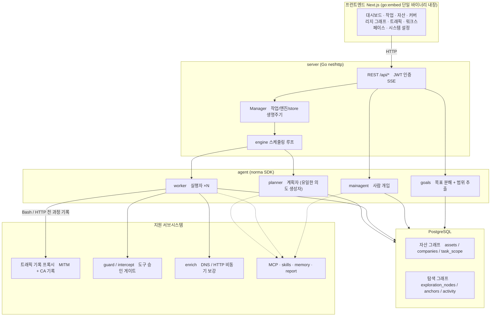
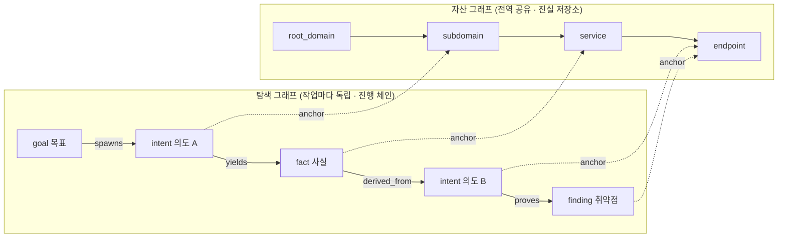
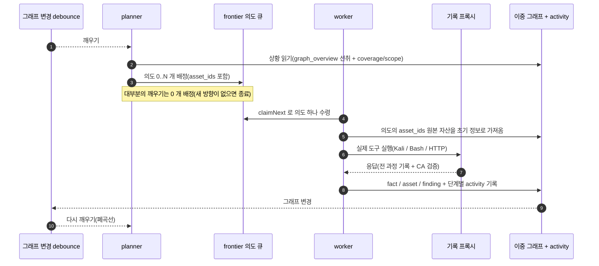
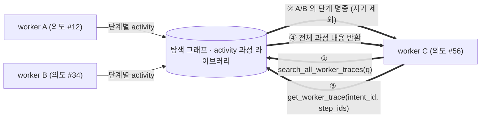
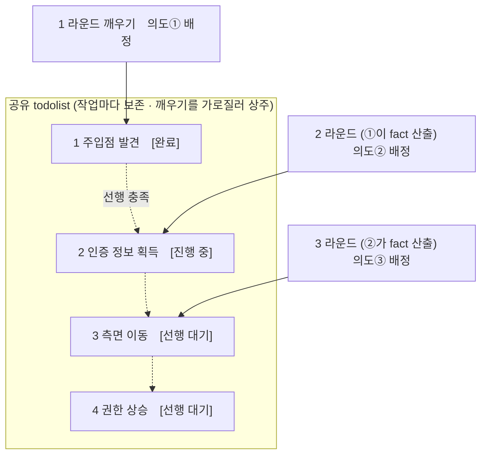

<div align="center">

# ARTEX 한국어판

**LLM 멀티 에이전트가 자율적으로 침투 테스트를 수행하는 시스템** (Go 백엔드 + Next.js 프런트엔드)

화면과 산출물은 한국어가 기본이며, **설정(시스템 → 설정 → 표시 언어)에서 영어·중국어·스페인어로도 바꿀 수 있습니다.** 언어를 바꾸면 에이전트가 생성하는 리포트·요약·대화 응답의 언어도 함께 바뀝니다.

한국어 · [中文](README.zh.md) · [English](README.en.md)

[](https://github.com/jiwoochris/artex-ko/actions/workflows/ci.yml) [](https://github.com/jiwoochris/artex-ko/actions/workflows/detections.yml) [](https://github.com/jiwoochris/artex-ko/actions/workflows/web.yml) [](LICENSE)

</div>

---

> ## 🚨 보안·오남용 경고: 반드시 먼저 읽어 주세요
>
> **이 저장소는 권한을 받은 환경에서, 방어와 탐지 역량을 기르기 위한 목적으로만 쓰도록 공개합니다.**
>
> ARTEX 는 사람이 거의 개입하지 않아도 정찰부터 침투, 자료 반출까지 공격 과정을 스스로 수행할 만큼 강력한 자율 공격 도구입니다. 그만큼 오남용이 일으키는 피해도 큽니다. 2026년 10월 국내 여러 언론은 원본 ARTEX 가 국내 금융기관을 상대로 한 개인정보 유출 공격에 사용된 정황이 조사 당국에 포착됐다고 보도했으며, 관련 수사가 진행 중입니다. 이 한국어판을 공개하는 목적은 공격을 돕는 데 있지 않습니다. 방어하는 쪽이 이런 자율 AI 공격의 작동 원리를 이해하고, 탐지하고 차단하는 역량을 갖추도록 돕는 데 목적이 있습니다.
>
> - **허가 없는 사용은 그 자체로 범죄가 됩니다.** 자신이 소유하거나 서면으로 명시적 허가를 받은 대상이 아니라면, 어떤 시스템에도 스캐닝·탐지·익스플로잇을 실행하지 마십시오. 대한민국에서 권한 없이 정보통신망에 침입하는 행위는 정보통신망법 위반이고, 개인정보가 결부되면 개인정보보호법도 함께 적용됩니다.
> - **실제 서비스나 타인의 자산을 대상으로 삼지 마십시오.** 학습과 연구, 그리고 본인이 소유한 로컬 격리 환경(OWASP Juice Shop·DVWA 처럼 의도적으로 취약하게 만든 환경)에서만 검증하십시오.
> - **방어하는 관점으로 읽으십시오.** 이 저장소는 자율 AI 공격의 탐지 시그니처와 하드닝 체크리스트 같은 방어·탐지 자료를 함께 정리해 나갑니다. → **[자율 AI 공격 방어·탐지 가이드](docs/defense-ko.md)**
>
> 이 경고와 아래 [사용 제한·면책](#라이선스와-면책)에 동의하지 않는다면, 이 저장소를 내려받거나 사용하지 마십시오.

---

> **이 저장소는 중국산 오픈소스 프로젝트 [Autumn-27/ARTEX](https://github.com/Autumn-27/ARTEX)(AGPL-3.0 · 원본 저장소 현재 접속 불가, 2026-10 확인)를 한국 사용자와 팀이 그대로 쓸 수 있도록 현지화한 판본입니다.** 에이전트의 판단 성능을 보존하기 위해 내부 추론 프롬프트는 원문을 유지하고, 사용자에게 보이는 산출물(탐지 결과·요약·리포트·대화 응답)만 한국어로 강제합니다. 아래 "왜 한국어판인가"에서 방침을 설명합니다.

ARTEX 는 LLM 이 조종하는 여러 에이전트가 **스스로 목표를 쪼개고, 실제 도구를 실행하고, 발견한 자산과 취약점을 그래프에 쌓아 가며** 침투 테스트 과정을 자율적으로 끌고 가는 시스템입니다. Go 단일 바이너리 하나에 Next.js 프런트엔드가 내장되어 있고, 데이터는 PostgreSQL 에 저장됩니다.

---

<!--
  이 제목의 엠대시(—)는 의도적으로 보존합니다. 저장소 스타일은 한국어 산문에서 엠대시를
  콜론으로 바꾸지만, 이 제목만은 예외입니다. GitHub 앵커 슬러그
  (#️-먼저-읽어-주세요--사용-범위와-국내법-고지, 엠대시 양옆 공백이 이중 하이픈 "--" 이 됩니다)를
  다음 다섯 곳이 참조하기 때문입니다: CODE_OF_CONDUCT.md · CONTRIBUTING.md · SECURITY.md ·
  .github/PULL_REQUEST_TEMPLATE.md · .github/ISSUE_TEMPLATE/config.yml.
  엠대시를 콜론으로 바꾸면 슬러그의 이중 하이픈이 단일 하이픈이 되어 다섯 링크가 모두 끊어집니다.
  제목을 바꾸려면 다섯 참조의 앵커를 함께 고치고 `python3 -I scripts/check-doc-links.py` 가
  EXIT 0 을 유지하는지 확인하십시오.
-->
## ⚠️ 먼저 읽어 주세요 — 사용 범위와 국내법 고지

ARTEX 는 **자신이 소유하거나 서면으로 명시적 허가를 받은 대상에 대해서만** 사용할 수 있습니다. 허가 범위를 벗어난 스캐닝·탐지·익스플로잇은 그 자체로 불법이 될 수 있습니다.

- 대한민국에서 권한 없이 타인의 정보통신망에 침입하거나 장애를 일으키는 행위는 **「정보통신망 이용촉진 및 정보보호 등에 관한 법률」** 위반입니다.
- 침투 테스트 과정에서 수집·노출되는 개인정보는 **「개인정보 보호법」** 의 적용을 받습니다. 권한이 있더라도 개인정보 열람·보관·파기를 신중히 다뤄야 합니다.
- **학습·연구·로컬 격리 환경 검증** 목적으로 쓰십시오. 운영 중인 외부 시스템을 대상으로 삼기 전에는 반드시 서면 허가와 범위·시간창 합의를 확보해야 합니다.

자세한 라이선스·사용 제한·면책은 아래 [라이선스와 면책](#라이선스와-면책) 절에 있습니다. 이 도구를 사용하는 것만으로 사용자는 그 조건에 동의한 것으로 봅니다.

---

## 왜 한국어판인가

원본 ARTEX 는 프롬프트·UI·문서가 모두 중국어로 되어 있어, 국내 사용자가 결과를 읽고 팀과 공유하기가 번거로웠습니다. 이 한국어판은 다음을 목표로 합니다.

- **산출물의 한국어화**: 에이전트가 사람에게 내보내는 탐지 결과·사실 요약·최종 리포트·대화 응답을 한국어로 출력하도록 강제합니다. 명령·페이로드·코드·URL·로그 원문은 분석에 필요하므로 원본 그대로 둡니다.
- **성능 보존**: 에이전트의 판단을 좌우하는 내부 추론 프롬프트(행동 지침 본문)는 번역하지 않습니다. 원문으로 벤치마크된 동작을 유지하고, 출력 언어만 바꿔 번역에서 오는 품질 저하를 피합니다.
- **국내법 고지**: 정보통신망법·개인정보보호법 고지와 "권한 범위 안에서만 사용" 경고를 한국어로 분명히 제공합니다.
- **국내 스택 대응**: LLM 공급자를 프런티어 모델뿐 아니라 OpenAI 호환 엔드포인트(국산·오픈 모델)로 교체할 수 있습니다. 아래 [설정](#설정)을 참고하십시오.

> 현지화의 경계와 설계 방침은 저장소의 작업 문서에 더 자세히 적혀 있습니다. 상류(upstream) 저장소의 변경을 대조하기 쉽도록 원본 중국어 문서는 `README.zh.md` 로 보존합니다.

---

## 화면 미리 보기

아래 세 화면은 한국어화를 마친 실제 UI 입니다. 로컬 격리 샌드박스에서 뽑은 데모 데이터이고, 대상은 전부 가상의 `acme.com` 과 사설 대역입니다.

<p align="center">
  <br>
  <sub><b>대시보드</b>: 활성 작업·확인된 취약점·자산 노드·LLM 토큰 소비와 활동 흐름을 한 화면에서 봅니다.</sub><br>
  <sub>이 대시보드 화면은 라벨을 현지화하기 전에 뽑은 데모 캡처라, 'LLM Token 소비' 카드의 데이터 원본 이름이 아직 코드 식별자 <code>llm_usage</code> 로 보입니다. 현재 빌드는 같은 자리를 신버전 「계량 원장」·구버전 「활동 통계」 로 표시합니다.</sub>
</p>

<p align="center">
  <br>
  <sub><b>취약점</b>: 심각도·상태·자산·소속 작업으로 탐지 결과를 집계하고 CSV 로 내보냅니다.</sub><br>
  <sub>취약점 <b>제목</b>은 모델이 생성한 값이라, 대상 앱과 기술 용어를 따라 영어가 섞일 수 있습니다([모델 선택과 출력 언어](#모델-선택과-출력-언어) 참조). 제목 아래 설명과 화면 전체는 한국어로 나옵니다.</sub>
</p>

<p align="center">
  <br>
  <sub><b>대화</b>: 자율 실행 중에 사람이 끼어들어 힌트를 주고, 에이전트가 공격 체인을 한국어로 요약합니다.</sub>
</p>

원본(중국어 UI) 전체 화면은 [`README.zh.md`](README.zh.md#截图预览) 에서 볼 수 있습니다.

---

## 빠른 시작 (Docker Compose)

> **사전 요구:** Docker 와 Docker Compose. 데이터베이스는 **PostgreSQL** 이며 compose 가 함께 띄웁니다. 탐색에는 **LLM** 이 필요합니다(`ANTHROPIC_API_KEY` 또는 `OPENAI_API_KEY`, UI 에서도 설정 가능).

> **⚠️ 지금은 아래 `docker compose up -d` 빠른 시작이 바로 작동하지 않습니다.** `docker-compose.yml` 의 `artex` 서비스가 받도록 지정된 상류(원본) 이미지 `autumn27/artex` 는 현재 Docker Hub 에서 내려가 받을 수 없습니다(2026-10-09 확인). 그래서 이 명령은 이미지 pull 단계에서 `pull access denied`/`manifest unknown` 으로 실패합니다. 한국어판 화면과 출력은 아래 ["그 밖의 설치 방법"](#그-밖의-설치-방법)에 있는 **소스에서 단일 바이너리 컴파일** 경로로 빌드하면 바로 쓸 수 있습니다(현재 정상 작동을 확인했습니다). 한국어판 Docker 이미지의 배포는 준비 중입니다.

```bash
git clone https://github.com/jiwoochris/artex-ko.git
cd artex-ko
cp .env.example .env          # POSTGRES_PASSWORD 설정, ANTHROPIC_API_KEY 는 선택
docker compose up -d          # artex 이미지 + postgres 를 함께 기동
# → http://localhost:8787 접속 (처음 들어가면 /setup 에서 관리자 비밀번호 설정)
#   /setup 은 기동 로그에 찍힌 "설정 토큰"을 요구합니다: docker compose logs artex | grep '설정 토큰'
```

상류 이미지에는 자주 쓰는 도구(ripgrep·curl·vim·npm·nmap 등)가 들어 있고, compose 로 기동하면 `./skills` 와 `./data` 는 바인드 마운트로 호스트에 남아 컨테이너를 다시 만들어도 보존됩니다. 다만 위 경고대로 지금은 이 이미지를 받을 수 없어 이 Docker 경로를 바로 쓸 수 없으니, 한국어판은 아래 소스 컴파일 경로로 빌드하십시오.

### 그 밖의 설치 방법

원본 저장소는 설치 스크립트(`./install.sh`), 사전 컴파일 바이너리(Releases), 소스 단일 바이너리 컴파일 등 여러 방법을 제공합니다. 명령과 절차는 [`README.zh.md`](README.zh.md#安装)의 "安装"(설치) 절에 정리되어 있으며, 아래 핵심만 옮깁니다.

- **설치 스크립트:** `./install.sh` 를 실행하면 Docker 감지·설치 후 "① 전부 Docker" 또는 "② 로컬 컴파일 실행"을 고르게 합니다. 다만 기본값인 "① 전부 Docker" 는 위 빠른 시작과 같은 상류 이미지(`autumn27/artex`)를 받으려 하는데, 그 이미지가 현재 Docker Hub 에서 내려가 받을 수 없으므로(위 경고 참조) 이 경로는 지금 이미지 pull 에서 실패합니다. 스크립트도 그 상황을 감지하면 같은 안내를 내고 중단합니다. 한국어판 화면·출력은 "② 로컬 컴파일 실행"을 고르거나 아래 **소스에서 단일 바이너리 컴파일** 경로로 빌드하십시오.
- **소스에서 단일 바이너리 컴파일:**

  ```bash
  cd web && npm ci && npm run build:static && cd ..   # 1) 프런트엔드 정적 빌드
  rm -rf server/webui/dist && mkdir -p server/webui/dist && cp -a web/out/. server/webui/dist/   # 2) 내장 디렉터리로 동기화(재빌드 시 중첩 방지)
  CGO_ENABLED=0 go build -tags embedui -o artex ./cmd/artex   # 3) 프런트 내장 컴파일
  ./start.sh                                          # → http://localhost:8787
  ```

> 1) 단계의 `npm ci` 는 빌드에 필요한 devDependencies(예: `@tailwindcss/postcss`)를 함께 설치합니다. 셸에 `NODE_ENV=production` 이 설정돼 있으면 `npm ci` 가 devDependencies 를 건너뛰어 빌드가 `Error: Cannot find module '@tailwindcss/postcss'` 로 실패하므로, 이때는 `npm ci --include=dev` 로 받으십시오.

> 실행은 `./artex` 를 직접 돌리지 말고 `start.sh`(Windows 는 `start.bat`)로 하십시오. 이 스크립트는 종료 코드에 따라 프로그램을 다시 띄우는 감시자이고, UI 의 "원클릭 업데이트"도 이 스크립트가 처리합니다.

> **한 번에 실행(macOS·Linux):** `./run-local.sh` 는 Postgres 컨테이너 시작(`docker compose up -d --wait postgres`, Docker Desktop 이 꺼져 있으면 macOS 에서 켬) → 위 빌드(`build.sh`) → `start.sh -addr 127.0.0.1:8787 -proxy 127.0.0.1:8788` 를 차례로 합니다. DB 주소는 `ARTEX_PG_DSN` 이 있으면 그 값을, 없으면 `.env` 의 `POSTGRES_*` 로 만들며, 호스트에서 5432 포트에 닿도록 `docker-compose.override.yml` 로 포트를 열어 두어야 합니다. 코드가 바뀌지 않았으면 `./run-local.sh --no-build`, 완전히 내릴 때는 `./run-local.sh stop`(서버 중지 + `docker compose down`, DB 볼륨은 유지)입니다.

---

## 설정

**데이터베이스**(`config.json`, 또는 환경 변수 `ARTEX_PG_DSN` 로 덮어쓰기):

```json
{
  "database": {
    "host": "127.0.0.1", "port": 5432,
    "user": "artex", "password": "yourpass",
    "dbname": "artex", "sslmode": "disable"
  }
}
```

**LLM:** `export ANTHROPIC_API_KEY=sk-...`(또는 `OPENAI_API_KEY`), 혹은 UI 의 "LLM 설정" 페이지에서 입력합니다. API Key 대신 ChatGPT Plus/Pro 구독으로 로그인해 쓸 수도 있고([아래 참고](#chatgpt-구독으로-사용하기-api-key-없이)), 본인 PC 에서 개인적으로 쓰는 경우에 한해 직접 로그인한 공식 `claude` CLI 로 Claude 구독을 쓸 수도 있습니다([아래 참고](#claude-구독으로-사용하기-공식-claude-cli-개인-로컬-사용-전용)). 선택 환경 변수로 `ARTEX_LLM_PROVIDER` / `ARTEX_LLM_MODEL` / `ARTEX_LLM_BASE_URL` / `ARTEX_LLM_PROXY` 를 둘 수 있습니다. 국산·오픈 모델을 쓰려면 OpenAI 호환 `ARTEX_LLM_BASE_URL` 을 지정하십시오.

**동시성:** 작업마다 돌리는 worker 에이전트 수는 "시스템 설정"에서 조정합니다(기본값 3).

**자주 쓰는 인자:** `./start.sh -addr :8787 -proxy :8788` 에서 `-addr` 는 프런트엔드와 API 를 열고, `-proxy` 는 트래픽 기록 프록시 포트입니다. `-addr` 의 기본값은 `127.0.0.1:8787`(로컬 접속만)이며, 다른 기기에서 접속하려면 `:8787` 처럼 바인딩 주소를 명시해야 합니다(아래 "초기 설정 보호" 참고).

### ChatGPT 구독으로 사용하기 (API Key 없이)

ChatGPT Plus/Pro 구독의 사용량으로 모델을 호출할 수 있습니다. OpenAI 가 오픈소스·로컬 실행 앱에 공식으로 열어 둔 「Sign in with ChatGPT」 토큰 공유 경로를 쓰며, API Key 과금 대신 해당 ChatGPT 계정의 플랜 한도가 적용됩니다. 바뀌는 것은 인증뿐입니다. 에이전트 루프와 도구 호출은 기존 `openai-responses`(Responses API, `store:false`) 경로를 그대로 쓰므로 같은 모델이면 API Key 로 돌릴 때와 같은 방식으로 동작합니다.

**사용 방법**

1. 「시스템 → LLM」에서 「새로 만들기」를 누르고 **인증 방식**을 「ChatGPT 구독 (Plus/Pro)」으로 고릅니다.
2. 이름과 모델을 입력하고 **「ChatGPT로 로그인」** 을 누릅니다. 설정이 먼저 저장되고, 새 탭에서 OpenAI 로그인·권한 승인 화면이 열립니다. 승인하면 브라우저가 `http://127.0.0.1:<포트>/auth/callback` 으로 돌아오고 ARTEX 가 자동으로 연결을 마칩니다(`<포트>` 는 ARTEX 에 접속한 포트이며 기본값은 8787). 권한 요청에는 「ChatGPT 플랜 사용량 사용」 승인이 포함되어야 합니다. 빠지면 카드에 「권한 필요」가 뜨고 「권한 다시 허용」으로 다시 로그인할 수 있습니다.
3. 로그인되면 모델 칸 오른쪽의 새로고침 버튼이 **이 계정이 쓸 수 있는 모델 목록**을 불러옵니다(목록에 없는 모델도 직접 입력할 수 있습니다). 추론 강도(`reasoning.effort`)를 고르고 「연결 테스트」로 실제 호출을 확인한 뒤 저장합니다.
4. (선택) **Daybreak**: OpenAI 의 Trusted Access for Cyber(Daybreak) 승인을 받은 계정이면 「Daybreak 켜기」 스위치로 요청마다 `access_programs.cyber=daybreak_blue` 를 보냅니다. 계정 승인과 워크스페이스 관리자의 활성화가 먼저 필요하며(승인되지 않은 계정에서는 효과가 없거나 오류가 날 수 있습니다), 끄면(기본) 아무것도 보내지 않습니다. Blue 만 지원하고 Red 는 지원하지 않습니다. 같은 스위치가 `openai-responses` 형식의 API Key 프로필에도 나타납니다(승인된 API 프로젝트의 키여야 합니다). 이 구독 경로가 해당 필드를 받아 주는지는 공식 문서에 명시되어 있지 않으므로 「연결 테스트」로 확인하십시오.
4. 카드에서 「활성으로 설정」하거나 작업·에이전트에 이 설정을 지정합니다. 로그아웃하면 OpenAI 쪽 refresh token 폐기를 요청하고 이 서버의 토큰을 지웁니다.

**ARTEX 서버와 브라우저가 다른 컴퓨터일 때 (원격 서버 / Docker)**

OpenAI 의 리디렉션 주소는 반드시 `http://127.0.0.1:<포트>/auth/callback` 형식이라(포트만 바꿀 수 있음), 브라우저가 ARTEX 와 같은 호스트에 있을 때만 자동으로 돌아옵니다. Docker 는 8787 포트를 호스트에 게시해 두었고 브라우저가 같은 호스트라면 그대로 자동입니다. 브라우저가 다른 컴퓨터라면 승인 뒤 `127.0.0.1` 페이지가 열리지 않는 것이 정상입니다. 그때 **주소창의 URL 전체를 복사**해 로그인 영역의 「붙여넣기로 완료」 칸에 넣으면 같은 로그인이 마무리됩니다(코드는 일회용이고 10분 안에 써야 합니다).

**사용량 한도와 장애 전환**

ChatGPT 설정의 「Usage」에서 앱별 주간 한도를 걸 수 있습니다. 한도에 닿으면 `subscription_sharing_usage_limit_exceeded` 오류가 오며, OpenAI 문서가 구독 요청을 다른 결제 경로로 자동 전환하지 말라고 하므로, ARTEX 는 이를 API Key 의 잔액·할당량 소진처럼 취급하지 않습니다. 「LLM 순환」이 켜져 있어도 유료 API Key 설정으로 **자동 장애 전환하지 않고**, 한도에 닿았다는 안내와 함께 오류로 드러냅니다. ChatGPT 설정의 「Usage」에서 한도를 올리거나 풀린 뒤 다시 시도하십시오(`subscription_sharing_usage_unavailable` 같은 일시 오류는 한도 초과가 아닙니다).

**알려진 제한과 주의**

- **출력 토큰 상한(`max_tokens`)은 보낼 수 없습니다.** 구독 직접 경로가 `max_output_tokens` 등 일부 요청 필드를 지원하지 않아 ARTEX 가 제거합니다. 응답은 항상 스트리밍이며 세션 헤더도 쓰지 않습니다. 해당 입력은 이 인증 방식에서 숨겨집니다.
- **토큰은 API Key 와 같은 수준으로 DB 에 보관됩니다(`llm_profile_oauth`, 평문).** 화면·API 응답·로그·LLM 호출 기록(llmrec)에는 나오지 않지만, DB 와 백업에 접근할 수 있는 사람은 읽을 수 있으니 접근을 통제하십시오. refresh token 은 갱신할 때마다 새 값으로 회전하므로 같은 DB 를 여러 ARTEX 프로세스가 동시에 쓰는 구성은 지원하지 않습니다(갱신 직렬화가 프로세스 안에서만 보장됩니다).
- **개인·로컬 사용 범위입니다.** OpenAI 쿡북은 ChatGPT 플랜 사용량을 오픈소스 프로젝트와 로컬에서 도는 개인 프로젝트에 열어 두며, 유료·원격 호스팅 앱은 대기 명단 승인이 필요하다고 안내합니다. 한 계정을 여럿이 나눠 쓰는 용도로 쓰지 마십시오.
- **검증 범위.** 공식 문서의 흐름을 모의 발급자·모의 서버로 구현·시험했습니다(단위·통합 테스트). 실제 `auth.openai.com`·`api.openai.com` 과의 종단 간 호출은 이 저장소의 CI 에서 하지 않으므로, 처음 쓰는 환경에서는 「연결 테스트」로 확인하십시오. 모델 목록과 지원하는 추론 강도는 계정·시점에 따라 달라집니다.

**정책 근거.** ARTEX 는 OpenAI 가 공개한 방식만 씁니다. Codex CLI 같은 다른 도구의 토큰 파일(`~/.codex/auth.json`)을 읽거나 그 클라이언트 ID 를 빌리지 않고, ChatGPT 내부 `backend-api` 를 부르지 않으며, 공개 Responses API(`https://api.openai.com/v1/responses`)만 호출합니다.

- [Sign in with ChatGPT 쿡북](https://developers.openai.com/cookbook/articles/sign-in-with-chatgpt)
- [토큰 공유(오픈소스) — 로그인](https://developers.openai.com/siwc/token-sharing-open-source/sign-in)
- [토큰 공유(오픈소스) — 모델과 추론](https://developers.openai.com/siwc/token-sharing-open-source/models-and-inference)
- [OpenAI 도움말: 지원되는 오픈소스 도구](https://help.openai.com/articles/20001542)

**Claude 구독(Pro/Max)** 은 아래의 별도 방식으로만 쓸 수 있습니다. 서드파티 앱이 Claude.ai 로그인을 제공하거나 사용자의 자격 증명을 받아 요청을 대신 보내는 방식은 Anthropic 약관상 허용되지 않아 지원하지 않습니다.

### Claude 구독으로 사용하기 (공식 claude CLI, 개인 로컬 사용 전용)

> **기본값은 꺼짐입니다.** 본인의 Claude Pro/Max 구독으로, **본인 PC 에서, 혼자** 쓰는 경우만을 위한 기능입니다. 이 ARTEX 를 다른 사람에게 노출하거나 구독을 나눠 쓰지 마십시오. 허가받은 대상만 점검하고, Claude 의 거절을 우회하려 하지 마십시오. 자동화된 사용이 구독 약관 범위에 드는지는 Anthropic 이 판단하며, 어기면 Anthropic 이 이용을 제한·정지할 수 있습니다. 책임은 사용자에게 있습니다.

**동작 방식.** ARTEX 는 사용자가 직접 설치하고 직접 로그인한 **공식 `claude` CLI** 를 헤드리스 모드(`claude -p`, stream-json 입출력)의 하위 프로세스로 구동합니다. ARTEX 는 Claude 자격 증명을 읽지도(`~/.claude/.credentials.json`, 키체인, `CLAUDE_CODE_OAUTH_TOKEN` 등), 저장·기록·전달하지도 않습니다. 구독 자격으로 `api.anthropic.com` 을 직접 호출하지 않고, Claude Code 를 가장하는 헤더도 쓰지 않으며, `claude` 바이너리를 수정·패치·래핑하지 않고 문서화된 플래그만 씁니다. 인증은 전부 `claude` 안에서 일어나고, ARTEX 가 읽는 것은 `claude auth status` 가 돌려주는 JSON 의 로그인 여부와 인증 방식(`authMethod`)뿐입니다.

**에이전트 동작은 API Key 경로와 최대한 같게 유지됩니다.** 에이전트 루프는 ARTEX 가 그대로 쥐고, 모델 호출 한 번이 `claude` 의 응답 한 번에 대응합니다(공급자 브리지). `claude` 의 내장 도구는 모두 끄고(`--tools ""`) ARTEX 도구만 `127.0.0.1` 전용 MCP 로 보여 줍니다(이름 앞에 `mcp__artex__` 가 붙음). 도구 호출은 MCP 응답을 보류해 두었다가 ARTEX 가 실행한 결과를 돌려주므로, 권한 검사·승인·훅·트래픽 캡처·발견/자산/그래프 기록·전사·활동 기록은 API Key 경로와 같은 ARTEX 코드가 처리합니다. 역할 프롬프트는 번역·수정 없이 `--system-prompt-file` 로 그대로 넘깁니다.

**사용 방법**

1. 터미널에서 Claude Code(2.1.259 이상)를 설치하고 **직접** `claude auth login` 으로 본인 구독에 로그인합니다. `claude auth status` 의 인증 방식이 `claude.ai` 여야 합니다.
2. 「시스템 → LLM」에서 「새로 만들기」 → **인증 방식** 「Claude Code (구독, 개인 로컬 사용)」를 고릅니다. 패널의 안내를 읽고 확인란에 체크한 뒤 **켜기** 를 누릅니다(설치 전체에 적용되는 옵트인 스위치).
3. 모델(별칭 `sonnet`·`opus` 같은 예시를 직접 입력하거나 전체 이름을 입력, 비우면 `claude` 기본 모델)과 추론 강도(`low`~`max`, `--effort` 로 전달)를 정하고 「연결 테스트」로 실제 호출을 확인한 뒤 저장합니다. `claude` 가 없거나 버전이 낮거나 로그인되어 있지 않으면 패널과 테스트 결과가 이유를 알려 줍니다.
4. 카드에서 「활성으로 설정」하거나 작업·에이전트에 이 설정을 지정합니다.

**환경과 격리**

- 자식 프로세스 환경은 **허용 목록**으로 만듭니다. `PATH`·`HOME`·로캘·임시 디렉터리·Windows 시스템 변수·프록시/TLS 변수·`CLAUDE_CONFIG_DIR`·`XDG_*` 만 넘기고 나머지는 모두 뺍니다. 그래서 `ANTHROPIC_API_KEY`·`ANTHROPIC_AUTH_TOKEN`(있으면 `claude` 가 구독 대신 API 과금으로 가기 때문입니다)은 물론 `CLAUDE_CODE_OAUTH_TOKEN`·`ANTHROPIC_BASE_URL`·`CLAUDE_CODE_USE_*` 같은 경로 전환 변수와 나중에 생길 새 변수도 자동으로 빠집니다. 사용자 개인 설정(CLAUDE.md, 자동 메모리, 훅, 플러그인, 백그라운드 작업 등)이 에이전트에 새어 들어오지 않게 환경 변수와 플래그로 격리하며 전용 빈 작업 디렉터리에서 실행합니다. `--bare` 는 구독 로그인을 무시하므로 쓰지 않습니다.
- `authMethod` 가 `claude.ai` 또는 `oauth_token` 이 아니면(`api_key`, `api_key_helper`, 제3자 공급자 등) **API 과금 경로로 보고 거절**합니다.
- MCP 엔드포인트는 `127.0.0.1` 의 임의 포트에만 열리고, 프로세스마다 256비트 토큰 경로를 쓰며 Host/Origin 헤더를 검사합니다.
- ARTEX 가 `127.0.0.1` 이외의 주소에서 접속 가능하게 실행 중이면 켜지 않습니다(소유자가 직접 확인한 배포, 예를 들어 호스트의 `127.0.0.1` 로만 포트를 게시한 컨테이너는 환경 변수 `ARTEX_CLAUDE_CODE_ALLOW_NONLOOPBACK=1` 로 허용). 공식 Docker 이미지에는 `claude` 가 들어 있지 않으므로, 이 기능은 호스트에서 ARTEX 를 직접 실행하는 구성을 권장합니다.

**한도와 동시성**

- 동시에 모델 응답을 만드는 `claude` 프로세스의 전역 상한은 기본 1, 설정으로도 최대 3 입니다. 도구 실행을 기다리는 프로세스는 슬롯을 쥐지 않습니다. 응답 중 출력이 한동안(기본 10분) 없으면 멈춘 것으로 보고 프로세스를 정리해 슬롯을 돌려줍니다(`claude` 가 API 를 재시도 중이라고 알리는 동안은 시간이 연장되지만 횟수 상한이 있습니다).
- 살아 있는(대기 중인) `claude` 프로세스는 기본 8개까지 두고, 넘으면 도구 결과를 기다리는 세션보다 유휴 세션을, 같은 부류에서는 가장 오래 놀던 것을 먼저 정리합니다(정리된 세션은 다음 호출에서 전사를 다시 넣고 이어 갑니다). 환경 변수 `ARTEX_CLAUDE_CODE_MAX_LIVE` 로 조절합니다.
- 구독 사용량 한도에 닿으면 새 요청을 보내지 않고(알려 준 해제 시각까지, 모르면 30분, 최대 12시간) 오류를 그대로 드러냅니다. 5시간·주간 한도는 계정 전체에 걸리지만, 모델별 한도(예: Opus 주간 한도)는 그 모델의 프로필만 막고 다른 모델 프로필은 계속 쓸 수 있습니다. 「LLM 순환」이 켜져 있으면 다음 설정으로 장애 전환됩니다. 일시적 속도 제한·과부하는 30초에서 5분까지 지수 백오프를 둡니다. 촘촘한 재시도나 계정 교체는 하지 않습니다.

**알려진 제한 (API Key 경로와의 차이)**

- `claude` 자체의 에이전트 루프와 자동 컨텍스트 압축이 ARTEX 의 압축과 별개로 함께 돌 수 있습니다.
- ARTEX 가 대화 앞부분을 압축했거나, 프로세스가 재시작·10분 유휴 만료된 뒤에는 대화를 **텍스트 전사로 다시 넣습니다**(구조화된 `tool_use` 블록이 아님). 같은 내용이지만 모델이 받는 형식이 미묘하게 다를 수 있습니다.
- `--system-prompt-file` 로 기본 프롬프트를 교체하지만 바이너리가 자체 식별 문구를 덧붙일 수 있습니다. 도구 이름의 `mcp__artex__` 접두사는 시스템 프롬프트 끝의 짧은 코드 고정 안내로 알립니다.
- 출력 토큰 상한, temperature, 초당·분당 속도 제한, thinking 방식은 적용되지 않습니다(화면에서 숨김). 응답은 항상 스트리밍입니다.
- 같은 도구를 같은 인자로 동시에 여러 번 부르면 결과 짝짓기가 호출 도착 순서에 의존합니다. 인자가 다르면 인자로 정확히 짝짓습니다.
- `claude setup-token` 으로 만든 토큰을 환경 변수(`CLAUDE_CODE_OAUTH_TOKEN`)로 넘기는 방식은 지원하지 않습니다. ARTEX 가 자격 증명을 전달하지 않는 원칙에 따라 자식 프로세스 환경에서 이 변수를 지우므로, `claude auth login` 으로 저장된 로그인을 쓰십시오.
- 사용자 대면 오류 일부는 한국어로만 나옵니다.
- **검증 범위.** `claude` 의 stream-json 출력 형식은 공식 문서를 근거로 한 가정이며, 이 저장소의 테스트는 그 가정을 따르는 가짜 `claude` 로 돌립니다(도구 왕복, 다중 도구, 사용량 한도, 크래시, 취소, 동시 실행 상한, 환경 정제 등). 실제 `claude` 와의 종단 간 호출은 CI 에서 하지 않으므로, 처음 쓰는 환경에서는 「연결 테스트」와 짧은 작업으로 먼저 확인하십시오.

**정책 근거와 불확실한 점.** Anthropic 문서는 Claude Code 를 공식 CLI 로, `claude -p`(헤드리스)와 `claude setup-token` 을 스크립트·자동화용으로 설명하며, 개인이 자신의 구독으로 공식 CLI 를 쓰는 것과 서드파티가 자격 증명을 다루거나 구독으로 다른 사람에게 서비스하는 것을 구분합니다. ARTEX 는 앞쪽 형태만 취합니다. 그러나 소비자 약관은 명시적으로 허용되지 않은 자동화된 접근, 계정 공유를 제한하고 사전 통지 없이 이용을 정지할 수 있다고 정하므로, **밤새 도는 자율 에이전트 루프가 「보통의 개인 사용」에 드는지는 Anthropic 이 판단할 일이며 ARTEX 가 보장할 수 없습니다.** 모델을 API Key 로 쓰는 것이 가장 안전한 선택이며, 서드파티 앱이 Claude.ai 로그인을 제공하거나 사용자의 Free·Pro·Max 자격 증명으로 요청을 대신 보내는 방식은 여전히 지원하지 않습니다.

- [Claude Code 법적·준수 사항](https://code.claude.com/docs/en/legal-and-compliance)
- [인증](https://code.claude.com/docs/en/authentication)
- [헤드리스 사용(`claude -p`)](https://code.claude.com/docs/en/headless)
- [CLI 레퍼런스](https://code.claude.com/docs/en/cli-reference)
- [Anthropic 소비자 약관](https://www.anthropic.com/legal/consumer-terms)

### 모델 선택과 출력 언어

산출물의 한국어화는 하드 코딩된 상한이 아니라 **프롬프트 지시(`agent/prompt.go` 의 `langDirective()`)로 유도**합니다. 그래서 출력이 한국어로 유지되는 정도는 모델의 역량과 역할, 맥락에 따라 달라집니다.

- **역량 있는 프런티어 모델을 권장합니다.** 로컬 격리 샌드박스에서 프로덕션 지시문만 적용한 짧은 검증 실행 결과, 기본 모델 `claude-opus-4-8` 은 planner·worker·reporter 산출물과 권한 보유 샌드박스 계획 요청까지 네 역할 모두에서 사용자 노출 출력을 한국어로 유지했고 거부가 없었습니다. `gpt-4o` 도 같은 시나리오에서 한국어를 유지했습니다. 반면 저가·소형 모델(예: `gpt-4o-mini`)은 리포트가 원문(중국어)으로 되돌아갔습니다. 출력 언어 품질이 모델 역량에 직접 좌우되므로, 사람이 리포트를 읽는 환경이라면 역량 있는 모델을 쓰십시오.
- **역할·맥락에 따른 드리프트가 남을 수 있습니다.** 언어 자체보다 역할·출력 형식에서 어긋남이 더 자주 나타납니다. 특히 worker 의 최종 한 문장 요약처럼 짧은 산출물에서는 모델이 영어 사고 과정을 그대로 노출하거나, `report_finding` 의 구조화 필드가 대상 앱·기술 용어를 따라 영어로 기울 수 있습니다. 과거 실행에서는 `gpt-4o` 의 planner 상황 요약이 일부 턴에서 중국어로 돌아간 적도 있습니다. 작업 지시에 "한국어로 작성하라"를 명시하면 충실도가 올라갑니다.
- **추론형(reasoning) 모델에는 `max_tokens` 를 넉넉히 주십시오.** 사고 채널을 따로 쓰는 추론형 모델은 응답 토큰 상한이 작으면 그 예산을 내부 추론에 소진하고 사용자에게 보이는 최종 답변을 비워 둘 수 있습니다. 이때는 언어가 아니라 답변 자체가 사라지므로, 해당 LLM 프로파일의 `max_tokens` 를 충분히 크게 잡으십시오.

> **OpenAI 호환 경로의 토큰 상한 함정.** `gpt-4o` 처럼 OpenAI 계열 모델은 응답 토큰 상한이 16,384 입니다. 그런데 OpenAI 호환 요청에는 기본적으로 더 큰 출력 상한(32,768)이 실려, 그대로 두면 모든 호출이 `400 (max_tokens is too large)` 으로 실패합니다. 이때는 **LLM 설정에서 해당 프로파일의 `max_tokens` 를 16,384 이하로 지정**하십시오. Anthropic 계열(기본 모델 `claude-opus-4-8` 등)은 32,768 을 허용하므로 이 함정에 걸리지 않습니다.

### 초기 설정 보호 (첫 실행 토큰과 바인딩 주소)

관리자 계정은 하나(`ARTEX`)이고 비밀번호는 첫 접속 때 `/setup` 에서 만듭니다. 비밀번호가 아직 없는 인스턴스에 먼저 닿은 사람이 계정을 차지하지 못하도록 다음 보호가 걸려 있습니다.

- **설정 토큰.** 비밀번호가 없는 상태로 기동하면 서버 콘솔 로그에 `[auth] … 설정 토큰: …` 한 줄이 찍힙니다(Docker 는 `docker compose logs artex`). `/setup` 화면과 `POST /api/auth/init`(`setup_token` 필드)은 이 값이 맞아야 비밀번호를 만들고, 틀린 시도는 횟수 제한에 걸립니다. 무인 배포라면 `ARTEX_SETUP_TOKEN` 으로 토큰을 고정하거나 `ARTEX_ADMIN_PASSWORD` 로 비밀번호를 바로 넣을 수 있습니다(8자 이상).
- **기본 바인딩은 127.0.0.1 입니다.** `artex` 의 `-addr` 기본값과 `docker-compose.yml` 의 포트 게시 모두 호스트의 루프백에만 엽니다. 다른 기기에서 직접 접속하려면 `-addr :8787` 또는 `.env` 의 `ARTEX_BIND=0.0.0.0` 으로 바꾸되, 초기 설정을 먼저 마치고 가능하면 아래 리버스 프록시 구성을 쓰십시오. 비밀번호가 없는 채로 루프백이 아닌 주소에 바인딩하면 기동 로그에 경고가 찍힙니다.
- **비밀번호를 바꾸면 기존 세션이 모두 끊깁니다.** 토큰 서명 키가 비밀번호 해시에 묶여 있어서, 화면의 비밀번호 변경·`reset-password.sh`·DB 직접 수정 어느 쪽이든 이전에 발급된 토큰은 몇 초 안에 무효가 됩니다. 계정이 유출된 뒤 복구할 때는 비밀번호를 바꾼 다음 커스텀 도구·MCP·LLM·알림 설정도 함께 점검하십시오.
- **CORS.** `/api` 는 `ARTEX_CORS_ORIGINS`(쉼표 구분)에 적힌 출처에만 교차 출처 호출을 허용합니다. 내장 UI 는 동일 출처라 보통 비워 두고, 기본값은 `dev.sh` 의 `next dev`(`http://localhost:5173`)만 허용합니다.

### 리버스 프록시 배포 (HTTPS / 443 만 개방)

프런트엔드와 API/SSE 모두 같은 백엔드 포트(기본 `:8787`)가 제공하고, 실시간 활동 스트림은 기본적으로 **동일 출처(same-origin)** 로 연결합니다. 따라서 `NEXT_PUBLIC_SSE_BASE` 를 따로 설정할 필요 없이, 공개망에는 443 만 열고 8787 은 내부망에 두면 됩니다.

SSE 는 장시간 연결로 이벤트를 계속 밀어 주므로, 리버스 프록시에서 **버퍼링을 반드시 꺼야** 합니다. 끄지 않으면 브라우저가 연결은 되지만 이벤트를 못 받습니다(활동 스트림이 계속 로딩 상태로 보임). Nginx 설정 예시는 [`README.zh.md`](README.zh.md#反向代理部署https--只开放-443)에 있습니다.

---

## 시스템 아키텍처

ARTEX 는 **LLM 멀티 에이전트가 구동하는 자율 침투 시스템**입니다. Go 단일 백엔드(Next.js 프런트엔드 내장)에 PostgreSQL 을 쓰고, 에이전트 기능은 [`norma`](https://github.com/Autumn-27/norma)(현재 접속 불가, 2026-10 확인) SDK 가 제공합니다. 핵심은 **이중 그래프 구조**와, 그것을 둘러싼 두 가지 자율성 장치(worker 사이의 과정 단위 정보 교환, planner 의 다중 라운드 공유 todolist)입니다.

### 전체 계층



- **프런트엔드**: Next.js 정적 빌드를 `go:embed` 로 단일 바이너리에 내장합니다. 작업·자산·탐색 체인·커버리지 그래프를 시각화하고, 사람이 개입하는 대화를 제공합니다.
- **server**: `net/http` 라우팅과 JWT 인증, SSE 를 담당하고, `Manager` 가 작업·엔진·DB store 의 생명주기를 관리합니다.
- **engine**: 작업마다 `plannerLoop` 하나와 worker goroutine N 개를 돌리며, 의도 배정과 타임아웃·일시정지·드레인을 처리합니다.
- **agent**: goals / planner / worker / mainagent 로 나뉘고, `ToolSet` 이 이중 그래프를 LLM 도구로 노출합니다.
- **db**: 이중 그래프를 PostgreSQL(pgx)에 저장하고, `go:embed` 로 들어간 스키마가 매 기동마다 멱등하게 테이블을 만듭니다.
- **지원**: 기록형 MITM 프록시, 승인 게이트, 비동기 보강, MCP·스킬·메모리·리포트.

### 이중 그래프 구조: 탐색 그래프 + 자산 그래프

시스템은 "대상이 무엇인가"와 "어디까지 테스트했는가"를 서로 독립적이면서 앵커로 연결되는 두 그래프로 나눕니다.

- **자산 그래프(Asset Graph, 전역 공유)**: 작업을 가로질러 공유하는 자산 진실 저장소입니다. 노드는 `root_domain / subdomain / ip / service / app / endpoint` 이고 회사에 귀속됩니다. 도메인→서브도메인→서비스→엔드포인트의 부모·자식 관계와 중복 제거 키는 전부 프로그램이 계산하며, 에이전트는 원본 정보만 제출합니다.
- **탐색 그래프(Exploration Graph, 작업마다 독립)**: 한 작업의 "사고와 진행" 과정입니다. 노드는 `goal(목표) / intent(의도) / fact(사실) / finding(취약점) / hint(힌트)` 이고, `spawns / derived_from / yields / proves` 같은 간선으로 혈통 체인을 이룹니다.
- **두 그래프는 앵커로 연결됩니다.** `exploration_anchors(node_id, asset_id)` 가 의도·사실·취약점을 구체적인 자산에 고정합니다. 덕분에 탐색 방향에서 그것이 어떤 자산을 공략했는지, 반대로 어떤 자산이 이번 작업에서 어떤 의도로 테스트되고 어떤 사실을 냈는지를 양방향으로 조회할 수 있습니다.



> 역할 분담: **planner** 는 탐색 그래프의 상황을 읽고 목표를 판정하며, 아직 커버하지 못한 새 방향이 있을 때만 **의도**를 frontier 에 보냅니다. **worker** 는 **의도 하나**를 맡아 실제 도구로 실행하고, 새 자산·사실·취약점을 두 그래프에 써 넣은 뒤 멈춥니다. 자산 그래프는 공유 사실이고, 탐색 그래프는 작업마다의 진행 체인입니다.

### 엔진과 의도 생명주기 (한 번의 탐색 폐곡선)

엔진은 **이벤트 구동** 폐곡선입니다. 그래프가 바뀌면 planner 를 깨우고, planner 가 의도를 보내면 worker 가 그 의도를 맡아 실행한 뒤 결과를 써 넣으며, 그 쓰기가 다시 다음 라운드를 촉발합니다. 이 순환은 목표가 증명될 때(`prove_goal`)까지 이어집니다.



### worker 사이의 과정 단위 정보 교환

깊은 탐색에서는 값진 관찰(어떤 오류, 어떤 응답 조각, 숨은 파라미터)이 한 worker 의 **실행 과정**에서 나오지만 정식 fact 로는 기록되지 않는 경우가 많습니다. 중복 노동을 피하고 뒤따르는 worker 가 앞선 관찰 위에 설 수 있도록, worker 는 **다른 work 의 과정을 검색하는** 능력을 갖습니다.

- `search_all_worker_traces(q)`: 같은 작업의 다른 work 실행 과정을 키워드로 검색합니다(자기 의도의 단계는 자동 제외). 명중 항목에는 `intent_id` 가 붙습니다.
- `list_worker_traces` / `get_worker_trace(intent_id, step_ids=[…])`: 어떤 work 들이 돌았는지 먼저 보고, 특정 work 의 몇 단계만 전체 내용으로 가져와 세부를 교환합니다.

이렇게 탐색 그래프에 아직 대응하는 fact 가 없어도 뒤따르는 worker 가 남의 과정 속 관찰을 재사용합니다. 정보는 worker 사이를 "실행 과정" 단위로 흐르되, 경계는 그대로입니다(각 worker 는 여전히 자기가 맡은 의도 하나만 수행).



### planner 의 다중 라운드 공유 todolist → 안정적인 공격 체인

실제 공격 체인은 앞뒤로 의존하는 여러 단계의 순서(예: 주입점 발견 → 인증 정보 획득 → 측면 이동 → 권한 상승)인 경우가 많아, 이것을 한 번에 병렬로 내려보내면 뒤엉킵니다. 그래서 planner 는 **작업마다 보존되고 깨우기를 가로질러 공유되는 계획 할 일 목록(todolist)** 을 가집니다.

- planner 는 이벤트 구동이라 그래프가 바뀔 때마다 깨어나지만 **매 깨우기가 새 세션**입니다. 공유 todolist 는 직렬 공격 체인을 **한 번만 기록**해 두고, 이후 여러 라운드에 걸쳐 **의존 관계대로 한 단계씩** 의도를 배정하게 합니다(한 라운드에 전체 체인을 앞당겨 펼치지 않음).
- 매 라운드마다 "선행 단계가 끝나고 그 단계가 의존하는 fact 가 이미 존재하는" 다음 단계에만 의도를 배정하고, 진행에 따라 목록을 갱신합니다(fact 로 충족된 단계를 완료 표시).



이로써 공격 체인은 "이벤트 구동 + 무상태 세션" 환경에서도 안정적으로 진행되고, 중복되지 않고, 순서가 어긋나지 않습니다. 이것이 ARTEX 가 여러 단계의 공격 체인을 자율로 완주하는 핵심입니다.

---

## 방어·탐지 자료

이 저장소는 자율 AI 공격을 **방어하는 쪽**이 그 작동 원리를 이해하고 탐지·차단 역량을 기르도록 돕는 것을 목표로 합니다. 위 아키텍처에서 본 ARTEX 의 동작을 **방어자 관점**으로 뒤집어, 무엇을 관측하고 어디를 조여야 하는지를 한국어로 정리한 가이드를 둡니다.

- **[자율 AI 공격 방어·탐지 가이드 (docs/defense-ko.md)](docs/defense-ko.md)**
  - 자율 AI 공격이 기존 스캐너와 무엇이 다른가, 왜 탐지가 어렵고 그래도 어떻게 탐지하는가
  - 방어자가 관측할 수 있는 지문(IoC·행동 시그니처): 대상 관점과 포렌식 관점으로 구분
  - 공격자가 노리는 진입점과 하드닝(보조 인증·본인확인, API 인가, 자격 증명 스터핑, 세션·비밀 관리)
  - WAF·SIEM·인증 로그 탐지 규칙(의사 규칙), 하드닝 체크리스트, 사고 대응 요약
  - 국내 공식 침해지표·보안 권고 채널(KISA·금융보안원·개인정보보호위원회)과 국내법상 신고 의무
- **[Defense & Detection Guide (영어판 · docs/defense-en.md)](docs/defense-en.md)**: 해외 팀·협업자와 공유할 수 있는 같은 내용의 영어판입니다.
- **[배포용 탐지 규칙 (detections/README.ko.md)](detections/README.ko.md)**: 위 가이드의 지문 탐지를 바로 쓸 수 있는 규칙으로 제공합니다. 호스트·로그·SIEM 계층은 [Sigma](https://sigmahq.io) 규칙(원자·상관, `sigma convert` 로 Splunk·Elasticsearch 등으로 변환)으로, 네트워크 계층은 enrich 프로브와 norma SDK WebFetch 의 User-Agent 를 겨냥한 [Suricata](https://suricata.io) 규칙으로 나눠 담았습니다.
  - **[ATT&CK 커버리지 레이어 (detections/attack/README.ko.md)](detections/attack/README.ko.md)**: 위 규칙이 겨냥하는 MITRE ATT&CK 기법을 [Navigator](https://mitre-attack.github.io/attack-navigator/) 레이어(JSON)로 정리해, 어떤 공격 행위에 어떤 규칙이 걸리는지 한눈에 보도록 했습니다. 기법은 규칙의 `attack.*` 태그에서만 가져왔고 추정으로 넣은 항목은 없습니다.
  - **[기계가 읽는 침해지표 목록 (detections/indicators/README.ko.md)](detections/indicators/README.ko.md)**: ARTEX 가 실제로 내보내는 고유 지문을 CSV 한 파일(`artex_indicators.csv`)로 모으고, 같은 지표를 MISP 이벤트(`artex_indicators.misp.json`)로도 함께 제공합니다. SIEM 조회 테이블이나 위협 인텔리전스 플랫폼(MISP·C-TAS·FSI 등 MISP 형식을 받는 곳)에 바로 가져올 수 있는 침해지표(IoC)입니다. 모든 값은 저장소 소스에서 확인한 문자열이고, 각 행에 출처 파일과 탐지 규칙을 함께 적었습니다.
  - **[호스트 분류(triage) 스크립트 (detections/triage/README.ko.md)](detections/triage/README.ko.md)**: SIEM 이나 네트워크 센서 없이 의심 호스트 한 대의 셸 앞에 선 대응자를 위한 읽기 전용 스크립트 [`artex_host_triage.py`](detections/triage/artex_host_triage.py) 입니다. 위 규칙과 같은 지문을 점검하고, 여기에 더해 로그나 네트워크로는 관측되지 않아 침해지표 CSV 가 의도적으로 Sigma 규칙 없이 둔 세 가지 호스트·DB 지표(서버 리슨 포트, 기록 프록시 엔드포인트, PostgreSQL 탐색 스키마)까지 호스트에서 직접 확인합니다. 추가 설치 없이 표준 라이브러리만으로 동작하며, 각 발견은 대응하는 침해지표 행과 같은 한계를 지닌 분류 단서일 뿐 그 자체로 단정하는 근거는 아닙니다.
  - 위 규칙과 레이어와 지표, 그리고 호스트 분류 스크립트의 자가 테스트는 모두 저장소 테스트([detections/tests/README.ko.md](detections/tests/README.ko.md))로 재실행해 검증합니다. 돌려 볼 수 없는 탐지 규칙은 주장일 뿐이라는 원칙을 따릅니다.

> 이 자료는 계속 보강됩니다. 보완할 탐지 규칙·하드닝 항목은 이슈로 제안해 주시고, 규칙을 직접 보내실 때는 [기여 가이드의 「탐지 규칙·탐지 테스트 기여」 절](CONTRIBUTING.md#탐지-규칙탐지-테스트-기여)에 정리한 계약(관측 가능한 사실에 접지, 한계 명시, 정적 검증 통과, 재현 가능한 테스트 동봉)을 따라 주십시오.

---

## 개발

로컬 개발과 테스트:

```bash
./dev.sh    # 백엔드(:8787) + 트래픽 프록시(:8788) + 프런트엔드 next dev(:5173) → http://localhost:5173
```

- 백엔드: `go run ./cmd/artex` (`-tags embedui` 없으면 프런트엔드를 내장하지 않음)
- 프런트엔드: `cd web && npm run dev` (`/api` 를 백엔드로 프록시, 핫 리로드)
- 테스트: `go test ./...`
- Mock 미리 보기(백엔드 없이): `cd web && NEXT_PUBLIC_MOCK=1 npm run dev`

그 밖의 개발 항목(수동 취약점 재검증 등)은 [`README.zh.md`](README.zh.md#开发)의 "开发"(개발) 절을 참고하십시오.

이 한국어판이 상류 ARTEX 에 더한 변경은 [변경 이력(CHANGELOG.md)](CHANGELOG.md)에 정리되어 있습니다.

---

## 라이선스와 면책

### 오픈소스 라이선스

이 프로젝트는 **GNU Affero General Public License v3.0(AGPL-3.0)** 으로 배포됩니다. 전체 조항은 저장소 루트의 [LICENSE](LICENSE) 파일에 있습니다.

누구나 자유롭게 사용·수정·배포할 수 있지만, **파생 저작물도 똑같이 AGPL-3.0 으로 공개해야 합니다.** 특히 이 프로젝트를 수정해 **네트워크를 통해(예: 온라인 서비스로 배포) 사용자에게 제공한다면, 그 사용자에게 대응하는 완전한 소스 코드를 공개해야 합니다.** 이 한국어판 역시 AGPL-3.0 을 그대로 유지합니다.

> ⚠️ **중요:** 오픈소스 라이선스 자체는 소프트웨어의 사용 용도를 제한하지 않습니다. 아래 "사용 제한"과 "면책"은 원저자가 사용자에게 추가로 요구하는 약정이자 엄중한 고지이므로 반드시 지켜 주십시오.

### 사용 제한

- 이 도구는 **소스 코드를 읽고 학습·연구하는 용도**, 그리고 **로컬 격리 환경에서 기술 원리를 검증**하는 용도로 쓰십시오.
- 자신이 소유하거나 **서면으로 명시적 허가를 받은 대상이 아니라면**, 어떤 웹사이트·온라인 서비스·연결된 시스템에도 스캐닝·탐지·익스플로잇·공격을 수행하지 마십시오.
- 불법 침입, 데이터 탈취, 서비스 거부(DoS), 그 밖에 파괴적·범죄적 활동에 사용하는 것을 엄격히 금지합니다.
- 사용자가 속한 국가·지역의 네트워크 보안·데이터 보호·컴퓨터 범죄 관련 법규(대한민국의 경우 정보통신망법·개인정보보호법 등)를 모두 준수해야 합니다.

### 면책

이 프로젝트는 "있는 그대로(AS IS)" 제공되며 명시적·묵시적 어떤 보증도 하지 않습니다. 원저자와 기여자는 이 도구의 사용(사용 방식의 적절성과 무관하게)으로 발생한 어떤 직접·간접 손해, 데이터 손실, 시스템 손상, 법적 분쟁에도 책임지지 않습니다. **이 프로젝트를 내려받거나 설치하거나 사용하는 것은 위 모든 조건을 읽고 이해하고 동의한 것으로 봅니다.**

**모든 법적 책임과 결과는 사용자 본인이 부담합니다.**

---

## 원본 프로젝트

- 원본 저장소: [Autumn-27/ARTEX](https://github.com/Autumn-27/ARTEX) (현재 접속 불가, 2026-10 확인)
- 원본 README(중국어): [README.zh.md](README.zh.md)
- 원본 온라인 데모(중국어 UI): [https://artex-demo.vercel.app/](https://artex-demo.vercel.app/) (현재 접속 불가, 2026-10 확인)
- 에이전트 SDK: [Autumn-27/norma](https://github.com/Autumn-27/norma) (현재 접속 불가, 2026-10 확인)
